<picture>
  <source media="(prefers-color-scheme: dark)" srcset="assets/header-dark.svg">
  
</picture>

  
  
  

I build web products end to end: interface, API, database and deployment. Lately that means multilingual SaaS, client sites, trading and data tools, and AI apps that run on local models instead of someone else's cloud.

- **Shipping** [OneScan Menu](https://onescan.menu): QR menus, reservations and kitchen-to-table ordering for restaurants
- **Building** a self-hosted AI hub with agents, memory and MCP tools
- **Based** in Bulgaria, working in English and Bulgarian

## Selected work

<a href="https://onescan.menu">
  <picture>
    <source media="(prefers-color-scheme: dark)" srcset="assets/onescan-dark.svg">
    
  </picture>
</a>

  <picture>
    <source media="(prefers-color-scheme: dark)" srcset="assets/tin-ai-hub-dark.svg">
    
  </picture>
  <a href="https://rtr-engineering.com"><picture>
    <source media="(prefers-color-scheme: dark)" srcset="assets/rtr-dark.svg">
    
  </picture></a>
  <picture>
    <source media="(prefers-color-scheme: dark)" srcset="assets/neural-trader-dark.svg">
    
  </picture>
  <picture>
    <source media="(prefers-color-scheme: dark)" srcset="assets/pricewatch-dark.svg">
    
  </picture>

Tin AI Hub, Neural Trader and PriceWatch live in private repos. Happy to walk through any of them.

## Stack

<!-- icons:start -->

<picture><source media="(prefers-color-scheme: dark)" srcset="https://skillicons.dev/icons?i=ts&theme=dark"></picture>
<picture><source media="(prefers-color-scheme: dark)" srcset="https://skillicons.dev/icons?i=js&theme=dark"></picture>
<picture><source media="(prefers-color-scheme: dark)" srcset="https://skillicons.dev/icons?i=python&theme=dark"></picture>
<picture><source media="(prefers-color-scheme: dark)" srcset="https://skillicons.dev/icons?i=react&theme=dark"></picture>
<picture><source media="(prefers-color-scheme: dark)" srcset="https://skillicons.dev/icons?i=nextjs&theme=dark"></picture>
<picture><source media="(prefers-color-scheme: dark)" srcset="https://skillicons.dev/icons?i=tailwind&theme=dark"></picture>
<picture><source media="(prefers-color-scheme: dark)" srcset="https://skillicons.dev/icons?i=sass&theme=dark"></picture>
<picture><source media="(prefers-color-scheme: dark)" srcset="https://skillicons.dev/icons?i=nodejs&theme=dark"></picture>
<picture><source media="(prefers-color-scheme: dark)" srcset="https://skillicons.dev/icons?i=fastapi&theme=dark"></picture>
<picture><source media="(prefers-color-scheme: dark)" srcset="https://skillicons.dev/icons?i=graphql&theme=dark"></picture>
<picture><source media="(prefers-color-scheme: dark)" srcset="https://skillicons.dev/icons?i=postgres&theme=dark"></picture>
<picture><source media="(prefers-color-scheme: dark)" srcset="https://skillicons.dev/icons?i=mongodb&theme=dark"></picture>
<picture><source media="(prefers-color-scheme: dark)" srcset="https://skillicons.dev/icons?i=sqlite&theme=dark"></picture>
<picture><source media="(prefers-color-scheme: dark)" srcset="https://skillicons.dev/icons?i=docker&theme=dark"></picture>
<picture><source media="(prefers-color-scheme: dark)" srcset="https://skillicons.dev/icons?i=cloudflare&theme=dark"></picture>
<picture><source media="(prefers-color-scheme: dark)" srcset="https://skillicons.dev/icons?i=linux&theme=dark"></picture>
<picture><source media="(prefers-color-scheme: dark)" srcset="https://skillicons.dev/icons?i=git&theme=dark"></picture>
<picture><source media="(prefers-color-scheme: dark)" srcset="https://skillicons.dev/icons?i=jest&theme=dark"></picture>

<!-- icons:end -->

<code>backend</code>&nbsp; Hono · Express · Drizzle · Better Auth · Strapi · Stripe · pgvector 
<code>ai</code>&nbsp; LM Studio · Ollama · MCP · Vercel AI SDK 
<code>observability</code>&nbsp; Splunk · Dynatrace 
<code>testing & infra</code>&nbsp; Playwright · Caddy · Docker Compose

---

Open to freelance and full-time web work. The fastest way to reach me is <a href="https://www.linkedin.com/in/v-tinev/">LinkedIn</a>.
