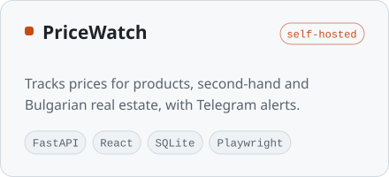

<picture>
  <source media="(prefers-color-scheme: dark)" srcset="assets/header-dark.svg">
  
</picture>

  
  

I build web products end to end: interface, API, database and deployment. Lately that means multilingual SaaS, trading and data tools, and AI apps that run on local models instead of someone else's cloud.

- **Building** a self-hosted AI hub with agents, memory and MCP tools
- **Shipping** OneScan Menu, a multi-tenant SaaS for restaurant QR menus
- **Based** in Bulgaria, working in English and Bulgarian

## Selected work

Most of these live in private repos. Happy to walk through any of them.

  <picture>
    <source media="(prefers-color-scheme: dark)" srcset="assets/onescan-dark.svg">
    
  </picture>
  <picture>
    <source media="(prefers-color-scheme: dark)" srcset="assets/tin-ai-hub-dark.svg">
    
  </picture>
  <picture>
    <source media="(prefers-color-scheme: dark)" srcset="assets/neural-trader-dark.svg">
    
  </picture>
  <picture>
    <source media="(prefers-color-scheme: dark)" srcset="assets/pricewatch-dark.svg">
    
  </picture>

**Client work:** [RTR Engineering](https://rtr-engineering.com), a company site with a React frontend and a Strapi CMS, deployed with Docker and Caddy.

## Stack

<picture>
  <source media="(prefers-color-scheme: dark)" srcset="https://skillicons.dev/icons?i=ts%2Cjs%2Creact%2Cnextjs%2Ctailwind%2Cnodejs%2Cpython%2Cfastapi%2Cpostgres%2Csqlite%2Cdocker%2Clinux&perline=12&theme=dark">
  
</picture>

Also: Hono · Drizzle · Better Auth · Strapi · Stripe · pgvector · Playwright · local LLMs (LM Studio, Ollama)

---

Open to freelance and full-time web work. The fastest way to reach me is <a href="https://www.linkedin.com/in/v-tinev/">LinkedIn</a>.
